  

MCA graduate specializing in Artificial Intelligence and Machine Learning, with a strong foundation in Python, SQL, data processing, and software development. Skilled in working with data using Pandas, NumPy, and Scikit-learn, with hands-on experience building projects involving machine learning, customer segmentation, and web applications. Familiar with REST APIs, databases, and modern development technologies. A quick learner with a problem-solving mindset, eager to apply technical knowledge to real-world challenges and contribute to data-driven and technology-focused teams.

## Focus areas

  

## Technology toolkit

  

## Skills

  

