  

## Focus areas

  

## Technology toolkit

  

## Skills

| Area | Skills |
| --- | --- |
| **Programming** | Python · Java (basics) · JavaScript · SQL · HTML5 · CSS3 |
| **Web & APIs** | React · Next.js · Node.js · Express.js · REST APIs · Tailwind CSS |
| **AI & data** | TensorFlow · Keras · scikit-learn · Pandas · NumPy · LLM APIs · Prompt design · EDA · Regression · Classification · K-Means · PCA |
| **Database** | MySQL |
| **Cloud & DevOps** | Linux · Git · GitHub · Docker · AWS (fundamentals) · Networking · Bash |
| **Tools** | Jupyter Notebook · Google Colab · Streamlit · Vercel |
