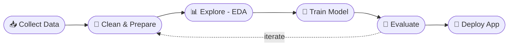

<div align="center">


<a href="https://github.com/numaaannn">
  
</a>

<br/>

[](https://numaansportfolio.vercel.app/)
[](mailto:numaan.y.opai@gmail.com)
[](https://instagram.com/numaan.38)


</div>

<br/>

## `01` &nbsp;📓 About &mdash; `profile.py`

```python
class NumaanOpai:
    """Data Science & Machine Learning enthusiast."""

    role       = "Aspiring Data Scientist"
    focus      = ["Data Analysis", "Machine Learning", "Full-Stack Apps"]
    learning   = "Data Science"
    exploring  = "TODO: deep learning / MLOps / LLM apps"   # edit me
    languages  = ["Python", "JavaScript", "Java", "Dart"]
    ask_me_about = ["Python", "Pandas", "scikit-learn", "React", "Flutter"]

    contact    = "numaan.y.opai@gmail.com"
    portfolio  = "https://numaansportfolio.vercel.app/"

    def mission(self):
        return "Take messy data, make it useful, put it in people's hands."
```

<br/>

## `02` &nbsp;🔬 My Workflow &mdash; `pipeline.md`



<br/>

## `03` &nbsp;🧪 Tech Stack &mdash; `requirements.txt`

| Layer | Tools |
| :-- | :-- |
| 🐍 **Data Science & ML** |  |
| 🌐 **Web** |  |
| 📱 **Mobile** |  |
| 🗄️ **Data & Tools** |  |

<br/>

## `04` &nbsp;🗂️ Model Card &mdash; `numaan_v1.0`

| | |
| :-- | :-- |
| **Task** | Learn, build, and ship data-driven projects |
| **Framework** | Python · pandas · scikit-learn · TensorFlow |
| **Training data** | Courses, projects, and curiosity |
| **Status** | 🟢 Actively training (`epochs=∞`) |
| **Best used for** | Collaboration, internships, data & ML projects |
| **Known limitations** | Still learning; occasionally overfits on coffee ☕ |

<br/>

## `05` &nbsp;🚀 Featured Projects &mdash; `results.csv`

> Replace each row with your best work (3 to 6 projects). Lead with a number: accuracy, users, time saved.

| Project | Problem → Result | Stack |
| :-- | :-- | :-- |
| 🔹 **[Project name](https://github.com/numaaannn/REPO)** | One line: what it solves and the metric (e.g. "Predicts X, 92% accuracy"). | `Python` `scikit-learn` |
| 🔹 **[Project name](https://github.com/numaaannn/REPO)** | One line: what it solves and the metric. | `TensorFlow` `Pandas` |
| 🔹 **[Project name](https://github.com/numaaannn/REPO)** | One line: what it solves and the metric. | `Next.js` `Tailwind` |

👉 Full list at **[numaansportfolio.vercel.app](https://numaansportfolio.vercel.app/)**

<br/>

## `06` &nbsp;📈 Metrics &mdash; `evaluate.py`

<div align="center">


</div>

<br/>

## `07` &nbsp;🎯 Roadmap &mdash; `todo.ipynb`

- [x] Learn the fundamentals of Data Science
- [ ] Ship a polished end-to-end ML project with a live demo
- [ ] Write one project up as a case study or blog post
- [ ] Contribute to an open-source data science library
- [ ] *TODO: add your own goal*

<br/>

## `08` &nbsp;🤝 Contact &mdash; `main.py`

```python
if __name__ == "__main__":
    print("Open to collaborations, internships & data/ML conversations.")
    send_message(to="numaan.y.opai@gmail.com")
```

<div align="center">

[](https://numaansportfolio.vercel.app/)
[](mailto:numaan.y.opai@gmail.com)


</div>
