<div align="center">


<a href="https://github.com/numaaannn">
  
</a>

<br/>

[](https://numaansportfolio.vercel.app/)
[](mailto:numaan.y.opai@gmail.com)

</div>

<br/>

## `01` About

```bash
numaan@ubuntu:~$ whoami
numaan-opai

numaan@ubuntu:~$ cat profile.yaml
name:       Numaan Opai
direction:  Junior DevOps / CloudOps Engineer (entry-level)
interests:  [Linux, automation, containers, cloud infrastructure, deployment pipelines]
approach:   Learn a tool, use it in a small project, document what broke and how I fixed it
goal:       Reliable, repeatable deployment workflows - from commit to running service
status:     Open to entry-level DevOps, CloudOps and infrastructure roles
```

I come from a data science and web development background, and I am now building DevOps skills from the ground up: Linux and networking first, then automation, containers, CI/CD and cloud. Every tool below is labelled by how far along I actually am with it.

<br/>

## `02` Learning Roadmap

```mermaid
flowchart LR
    subgraph S1["1 - Foundations"]
        direction LR
        A["Linux & Networking"] --> B["Git & GitHub"] --> C["Bash / Python Automation"]
    end
    subgraph S2["2 - Build & Ship"]
        direction LR
        D["Docker & Containers"] --> E["CI/CD Pipelines"]
    end
    subgraph S3["3 - Cloud & Scale"]
        direction LR
        F["AWS"] --> G["Terraform & Ansible"] --> H["Kubernetes"]
    end
    I["Monitoring, Logging & Troubleshooting"]

    S1 --> S2 --> S3 --> I

    classDef node fill:#300A24,stroke:#E95420,color:#EEEEEC;
    style S1 fill:#2C001E,stroke:#5E2750,color:#EEEEEC
    style S2 fill:#2C001E,stroke:#5E2750,color:#EEEEEC
    style S3 fill:#2C001E,stroke:#5E2750,color:#EEEEEC
    class A,B,C,D,E,F,G,H,I node;
```



> This is the order I am learning in, not a list of mastered skills. See the status table below for where I actually stand.

<br/>

## `03` Tech Stack

| Area | Tools |
| :-- | :-- |
| **OS & Scripting** |  |
| **Version Control** |  |
| **Containers & Orchestration** |  |
| **CI/CD** |  |
| **Cloud & IaC** |  |

**Honest status**

| Status | Technologies |
| :-- | :-- |
| Practiced | Git, GitHub, Python, Docker basics (run, ps, start, detached containers) |
| Learning now | Linux administration and networking, Bash, Docker images and Dockerfiles, GitHub Actions |
| Next up | AWS, Terraform, Ansible, Kubernetes, Jenkins, monitoring tools |

<!-- [REPLACE] Move a tool up a row only when a repository proves it. -->

<br/>

## `04` Background: Data Science & Web Development

Before moving toward DevOps, I worked in data science and web development. That background carries over: I write Python, build applications, and want to be the person who gets them deployed reliably.

| Experience | Where |
| :-- | :-- |
| Data Science Apprenticeship | Vigo Technoworld Pvt. Ltd. |
| Web Development Internship | Smart Software Solutions |

| Area | Tools I have used |
| :-- | :-- |
| **Data Science & ML** |  |
| **Web** |  |
| **Mobile** |  |
| **Databases** |  |

**Earlier projects**

| Project | What it is | Stack |
| :-- | :-- | :-- |
| **Customer Segmentation & Recommendation System** | MCA thesis: K-Means clustering (6 segments) with PCA for visualization, deployed publicly on Streamlit Cloud. | `Python` `scikit-learn` `Streamlit` |
| **Jewellery Store with AI Chatbot** | Online store deployed on Vercel with an AI chatbot. | `Next.js` `Vercel` |
| **AI Interview Engine** *(in progress)* | FastAPI multi-agent system with question, evaluation, memory and scoring agents. | `FastAPI` `Redis` `ChromaDB` |

<!-- [REPLACE] Add live-demo and repo links in the Project cells, e.g. **[Customer Segmentation](https://YOUR-STREAMLIT-URL)** -->

## `05` Featured Projects

Each project below is a planned build with a defined scope. Cards get a repository link once the work is published.

| Project | Problem and scope | Stack | Status |
| :-- | :-- | :-- | :-- |
| **Dockerized Application** | Package a sample app into an image; document build, run, ports, logs and troubleshooting. | `Docker` `Linux` | Planned |
| **CI/CD Pipeline** | GitHub Actions workflow that lints, tests and builds on every push. Deployment is added only once implemented. | `GitHub Actions` `Git` | Planned |
| **Linux Server Monitor** | Bash script checking disk, memory, CPU and service health, with logging and meaningful exit codes. | `Bash` `Linux` | Planned |
| **Cloud Deployment** | Deploy an app on AWS with documented architecture, networking, security and steps. | `AWS` `Docker` | Planned |

<!-- [REPLACE] When a project is done, change Status to "Complete" and put the repo link in the Project cell, e.g. **[Dockerized Application](https://github.com/numaaannn/YOUR-REPO)** -->

More of my earlier work, including web and data projects: **[numaansportfolio.vercel.app](https://numaansportfolio.vercel.app/)**

<br/>

## `06` DevOps Command Reference

Commands I am practicing. This is a study reference, not output from real infrastructure.

```bash
docker ps                  # list running containers
docker logs <container>    # read a container's logs
systemctl status nginx     # check whether a service is running
ss -lntp                   # show listening TCP ports and their processes
git status                 # see changed and staged files
```

| Command | What it tells you |
| :-- | :-- |
| `docker ps` | Which containers are up, their ports and uptime |
| `docker logs <container>` | Why an app crashed or misbehaved |
| `systemctl status nginx` | Service state plus the most recent log lines |
| `ss -lntp` | Whether a service is actually listening on the expected port |
| `git status` | The state of your working tree before a commit |

**Lab log: Docker basics on WSL Ubuntu**

Real session from my own machine while practicing container basics (prompt shortened, output trimmed).

```console
numaan@ubuntu:~/Linux$ docker run -it ubuntu bash
root@75d6eda7b846:/# docker ps -a
bash: docker: command not found
root@75d6eda7b846:/# exit

numaan@ubuntu:~/Linux$ docker start -ai wizardly_heisenberg
root@76d4545a1770:/# cat /etc/os-release
PRETTY_NAME="Ubuntu 26.04.1 LTS"
NAME="Ubuntu"
VERSION_ID="26.04"
VERSION="26.04.1 LTS (Resolute Raccoon)"
ID=ubuntu
ID_LIKE=debian
root@76d4545a1770:/# exit

numaan@ubuntu:~/Linux$ docker run -dit --name <name> ubuntu
484025e1c97c696b171c9e449b90169e000b07bba9ef92067cb3db3bfeadef24

numaan@ubuntu:~/Linux$ docker ps
CONTAINER ID   IMAGE     COMMAND       CREATED         STATUS
484025e1c97c   ubuntu    "/bin/bash"   2 minutes ago   Up 2 minutes
```

<!-- [REPLACE] <name> with the exact container name from your own docker run -dit --name command. -->

What this taught me:

- The `docker` CLI runs on the host. Inside the `ubuntu` container, `docker: command not found` is expected.
- A container stops when its main process exits. `docker start -ai` reattaches to a stopped one.
- `-it` gives an interactive shell; `-dit` keeps the container running in the background.
- Each image ships its own minimal userland, which `/etc/os-release` shows from inside the container.

<br/>

## `07` GitHub Activity

<div align="center">


</div>

<sub>Public activity only. Private contributions are not shown. If these cards fail to load, remove this section; the free service is occasionally rate-limited.</sub>

<br/>

## `08` Learning Milestones

- [ ] Strengthen Linux troubleshooting and system logs
- [ ] Complete Bash scripting exercises
- [ ] Build and document a Docker project
- [ ] Create a working CI/CD pipeline
- [ ] Deploy an application to a cloud environment
- [ ] Learn Infrastructure as Code (Terraform)
- [ ] Practice Kubernetes fundamentals
- [ ] Build a complete DevOps portfolio project

<br/>

## `09` Contact

```bash
numaan@ubuntu:~$ ./open_to_work.sh
Open to junior DevOps, CloudOps and entry-level infrastructure roles.
```

<div align="center">

[](https://github.com/numaaannn)
[](https://numaansportfolio.vercel.app/)
[](mailto:numaan.y.opai@gmail.com)


</div>

<!-- [OPTIONAL] Add LinkedIn badge once you confirm your URL:
[](YOUR_LINKEDIN_URL) -->
